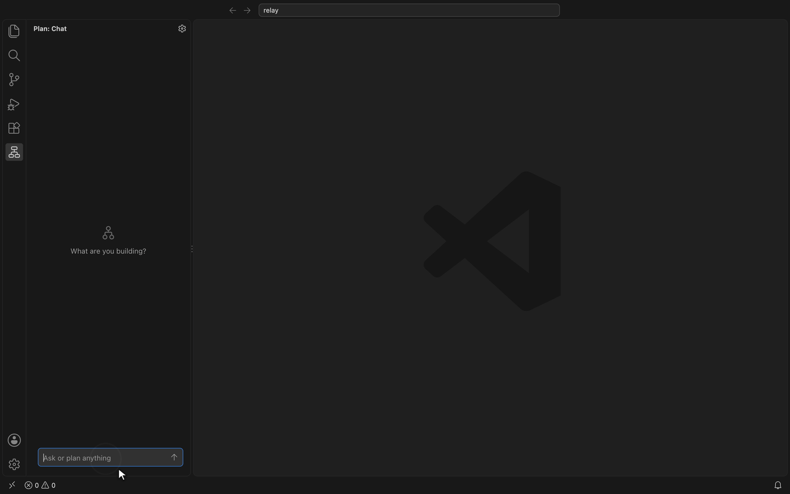

# idea-to-code

Plan software as nested flowcharts, with your coding agent.



Describe what you're building, and the plan takes shape as a chart you can walk through: features on the overview, each with its own flow, and steps that open into flows of their own. Your coding agent reads the same plan, builds from it and marks progress as it goes, and every change shows up on the chart.

- **Plan in your editor**, in the sidebar chat, or with Claude Code, Codex, Copilot, Cursor and other agents.
- **The plan lives in your repository** as plain YAML, next to the code it describes.
- **Every change is checked, recorded and undoable**, whoever made it.
- **Share a plan** as a single web page anyone can open.

## Get started

1. **Install idea-to-code** in VS Code, Cursor or VSCodium, from the [VS Code Marketplace](https://marketplace.visualstudio.com/items?itemName=idea-to-code.idea-to-code) or [Open VSX](https://open-vsx.org/extension/idea-to-code/idea-to-code), and open **Plan** in the activity bar.
2. **Connect your coding agent**, so it can read the plan and keep it up to date as it builds. For Claude Code:

   ```bash
   claude mcp add --scope user idea-to-code -- npx -y idea-to-code-mcp
   ```

   Copilot in VS Code needs nothing. [The full guide](packages/extension/README.md) has the setup for other agents, and covers planning and privacy.

The MCP server also works without the extension: see [its guide](packages/mcp/README.md).

## Develop

```bash
pnpm install
pnpm format:check && pnpm lint && pnpm typecheck && pnpm test && pnpm build   # the full check
pnpm package                                                                    # builds the .vsix
```

How the code is laid out, and the rules for changing it, are in [AGENTS.md](AGENTS.md).

## License

[MIT](LICENSE)
