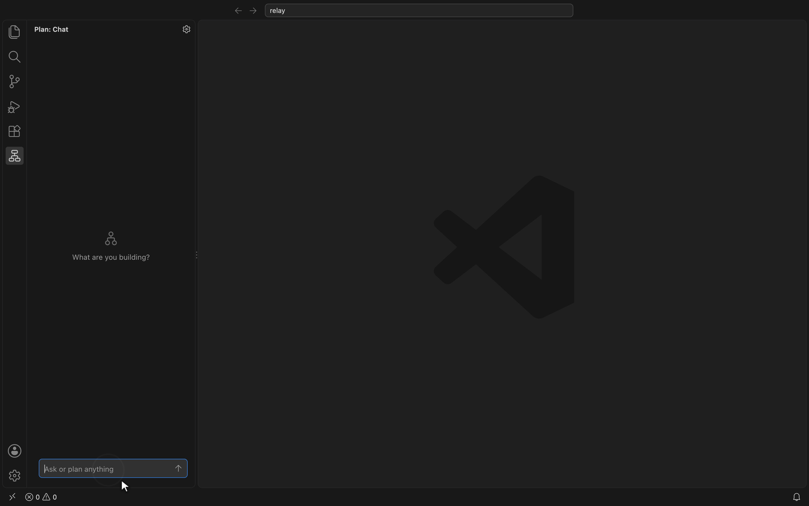
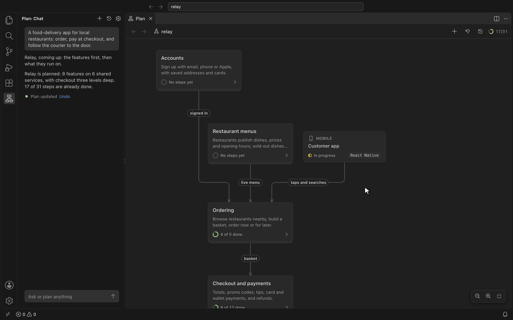
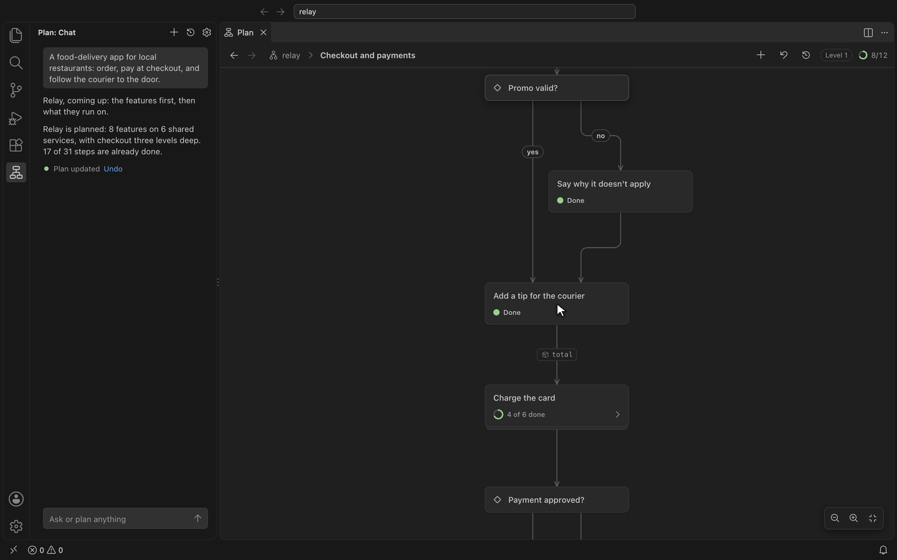
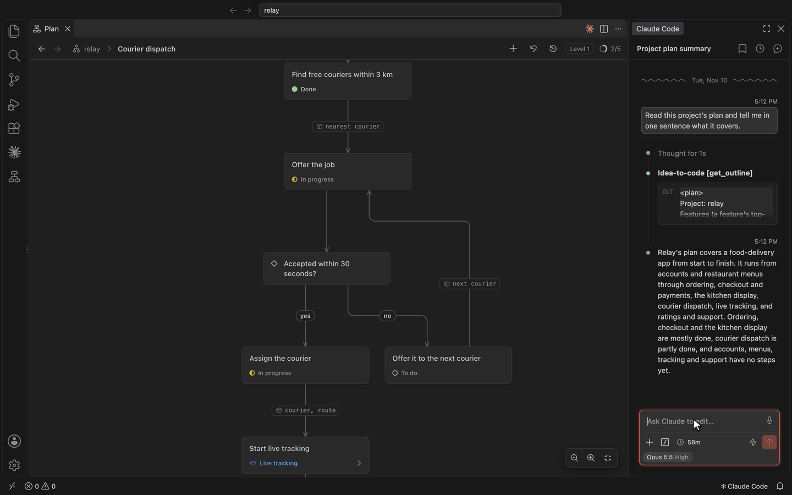

# idea-to-code

Plan software as nested flowcharts, with any coding agent. Works in VS Code, Cursor and VSCodium.



## Plan

1. Open **Plan** in the activity bar.
2. Describe what you're building. Your first message starts the plan.
3. When asked, choose a model: your editor's own models, or your own Anthropic, OpenAI, Google or OpenAI-compatible key.

The chart opens beside the chat and changes as the plan does. Click a card for its details. Double-click a card with a flow to go into it.



Ask for changes the same way, from wherever you are in the plan:



## Connect your coding agent

Your coding agent reads the plan, builds from it and marks progress through the idea-to-code MCP server. Set it up once and it works in every project. It needs Node.js 20 or later.

**Claude Code**

```bash
claude mcp add --scope user idea-to-code -- npx -y idea-to-code-mcp
```

**Codex**

```bash
codex mcp add idea-to-code -- npx -y idea-to-code-mcp
```

**Copilot in VS Code**: nothing to do. This extension provides the server.

**Cursor**, in `~/.cursor/mcp.json`:

```json
{
  "mcpServers": {
    "idea-to-code": {
      "command": "npx",
      "args": ["-y", "idea-to-code-mcp", "--root", "${workspaceFolder}"]
    }
  }
}
```

**Any other agent**: add a local (stdio) MCP server that runs `npx -y idea-to-code-mcp` in your project folder. Most agents take the same JSON as Cursor.

Then ask it things like:

- "Build the Bookings flow from the plan."
- "Map this codebase into the plan."
- "What's left to do in Payments?"

Every change your agent makes shows on the chart and in History, where you can undo it.



## Your files

- **The plan** lives in your project, in `plan/`, as YAML. Commit it with your code.
- **History** stays outside your project, in `~/Library/Application Support/idea-to-code` on macOS, `~/.local/share/idea-to-code` on Linux, or `%APPDATA%\idea-to-code` on Windows.
- **API keys** are kept in your editor's secret storage.

To share a plan, choose **Export as Web Page** from the `…` menu on the Plan tab. You get one file that opens in any browser.

## Privacy

- **The sidebar chat** sends your message, the chat so far and the parts of the plan it needs to the model you chose: your editor's own models, or Anthropic, OpenAI, Google or the address you set, with your key. Nothing else goes anywhere.
- **The MCP server** makes no network requests. Your coding agent sends what it reads from the plan to its own model, as it does with your code.
- **No telemetry.** The extension collects nothing about you or your plans.
